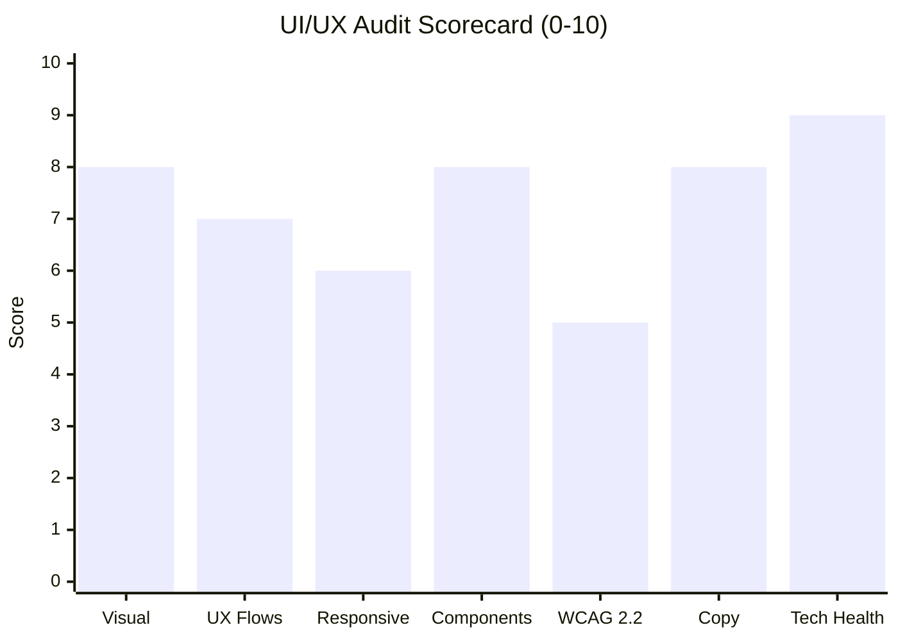
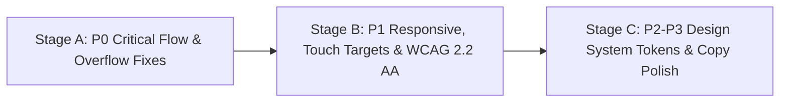

# Deliverable File Templates (Antigravity Artifact-Ready Edition)

Generate both files at the end of every investigation:
1. Write them to the workspace (or user-requested path) **and** to the Antigravity Artifact Directory (`<appDataDir>\brain\<conversation-id>\ui-ux-audit-report.md` and `<appDataDir>\brain\<conversation-id>\agent-fix-prompt.md` with `ArtifactMetadata`).
2. Replace all placeholders with verified evidence from the live browser session (`BROWSER_HOST_FACTS` or Browserbase session) and clickable workspace file links (`[File.tsx](file:///absolute/path/to/File.tsx#L10-L25)`).

---

## Deliverable 1: `ui-ux-audit-report.md`

````markdown
# UI/UX, Design System & Multi-Viewport Audit Report

> [!IMPORTANT]
> **Target URL:** <url>
> **Audit Date:** <YYYY-MM-DD>
> **Execution Engine:** <Antigravity Browser Subagent / Browserbase Session Link>
> **Authentication Scope:** <Public only / Authenticated via test account / Authenticated via user session>
> **Viewports Tested:** Desktop (`1440x900`, `1920x1080`, `1366x768`), Tablet/iPad (`768x1024`, `1024x768`), Mobile (`375x812`, `430x932`)
> **Overall Verdict:** <1-2 sentence executive summary>

## 1. Executive Scorecard (0-10)

| Dimension | Score | Key Evidence |
| :--- | :---: | :--- |
| **Visual Design & Hierarchy** | `X/10` | ... |
| **UX Architecture & Flows** | `X/10` | ... |
| **Responsive Quality (PC / iPad / Mobile)** | `X/10` | ... |
| **Interactive Components & Tabs** | `X/10` | ... |
| **WCAG 2.2 AA Accessibility** | `X/10` | ... |
| **Copywriting & Brand Authenticity** | `X/10` | ... |
| **Console & Asset Health** | `X/10` | ... |



## 2. Multi-Viewport Visual Walkthrough

*(If host-verified screenshots were captured and copied to `<appDataDir>\brain\<conversation-id>\`, embed them in a carousel below; otherwise omit the carousel block.)*

````carousel

<!-- slide -->

<!-- slide -->

````

## 3. Page, Tab & Component Coverage Matrix

| Page / Route | Source File (if repo) | Auth Scope | Desktop | iPad | Mobile | Tabs & Controls Tested | Console Errors |
| :--- | :--- | :--- | :---: | :---: | :---: | :--- | :---: |
| `/` | [page.tsx](file:///absolute/path/to/src/app/page.tsx) | Public | `WORKING` | `WORKING` | `PARTIAL` | ... | `0` |

## 4. Multi-Viewport Responsive & Layout Findings

### Desktop (`1440x900` / `1920x1080` / `1366x768`)
- ...

### iPad / Tablet (`768x1024` / `1024x768`)
- ...

### Mobile (`375x812` / `430x932`)
- **Horizontal overflow (`scrollWidth > innerWidth`):** <count & offending selectors>
- **Clipped text without ellipsis:** <count & offending selectors>
- **Undersized touch targets (`< 44x44px` / `< 24x24px` WCAG min):** <count & selectors>
- **Sticky header/bar height ratio & iOS auto-zoom inputs (`font-size < 16px`):** <details>

## 5. Reverse-Engineered Design System & Token Audit

- **Color Palette & Contrast:** Observed primary, surface, text, and border tokens + any `< 4.5:1` / `< 3.0:1` WCAG contrast failures.
- **Typography Scale:** Observed font families, heading scale, body sizes, and line heights.
- **Spacing, Radii & Elevation:** Observed border-radii and spacing values vs. arbitrary one-off values.

## 6. Copywriting & AI/Template Indicator Assessment

- **AI/Generic Template Indicator Score:** `XX%` (based on observable layout & copy heuristics)
- **Specific Copy Rewrites:** Current copy -> Recommended domain-specific copy + rationale

## 7. Consolidated Issue Register (`P0` – `P3`)

| ID | Severity | Page & Viewport | Component / Selector & Source File | Observed Evidence | Recommended Fix Spec | Acceptance Criteria |
| :--- | :---: | :--- | :--- | :--- | :--- | :--- |
| `UI-001` | `P0` | `/login` (`375x812`) | `#submit-btn` ([page.tsx](file:///.../page.tsx#L42)) | ... | ... | ... |

## 8. Phased Remediation Roadmap


````

---

## Deliverable 2: `agent-fix-prompt.md`

```markdown
# Coding Agent Fix Plan: <Site Name / URL>

> [!TIP]
> This remediation specification is structured for immediate execution by Antigravity (or any coding agent). Click **Proceed** or ask the agent to execute Batches 1–4 in order.

You are a Senior Frontend Design Engineer and Accessibility Specialist. Fix the verified UI, UX, responsive, design system, and WCAG 2.2 AA issues identified in the live multi-viewport audit of `<url>`.

## Strict Engineering Constraints

1. **Preserve Existing Functionality:** Do not break working routes, authentication guards, API contracts, database queries, or business logic.
2. **Design Token Consistency:** Standardize colors, typography, spacing, and border radii using the project's existing design system tokens (`src/lib/design-tokens.ts` / `tailwind.config.ts` / CSS variables) before patching individual components.
3. **Responsive Safety:** Every fix must pass with zero horizontal overflow (`document.documentElement.scrollWidth <= window.innerWidth`) across Desktop (`1440x900`, `1920x1080`), iPad (`768x1024`, `1024x768`), and Mobile (`375x812`, `430x932`).
4. **WCAG 2.2 AA Compliance:** Maintain `>= 4.5:1` normal text contrast (`>= 3.0:1` large text/UI), `>= 44x44px` mobile touch targets (`>= 24x24px` strict minimum), `font-size >= 16px` on mobile form inputs, visible `:focus-visible` rings, semantic heading hierarchy, and labeled form controls.

## Standardized Design Tokens to Enforce

```css
:root {
  /* Populate with verified & normalized palette, font, spacing, and radius tokens from the audit */
}
```

## Ordered Implementation Tasks

### Batch 1: P0 Critical Fixes (Flow Blockers & Severe Breakage)
- **[UI-001]** `<Component / Selector>` — [File.tsx](file:///absolute/path/to/File.tsx#L10-L25) (`<Page / Viewport>`)
  - **Observed Bug:** <exact measured issue>
  - **Required Code Change:** <exact JSX/CSS/Tailwind/ARIA change>
  - **Verification:** <concrete check>

### Batch 2: P1 High-Priority Responsive & WCAG 2.2 AA Fixes
- ...

### Batch 3: P2 Medium Design System & Component Consistency
- ...

### Batch 4: P3 Low Visual & Microcopy Polish
- ...

## Post-Fix Verification Checklist

Run these checks after applying all changes:
1. Run `npm run lint` / `tsc --noEmit` to confirm zero TypeScript or lint regressions.
2. Re-run the **Unified Single-Pass Mega-Probe** at `1440x900`, `768x1024`, and `375x812` and confirm:
   - `hasHorizontalOverflow === false` (`overflowCount === 0`)
   - `lowContrastCount === 0`
   - `unlabeledInputsCount === 0`
   - `brokenImagesCount === 0`
3. Verify keyboard navigation (`Tab`, `Shift+Tab`, `Enter`, `Escape`) across all interactive tabs, drawers, and modals.
```
