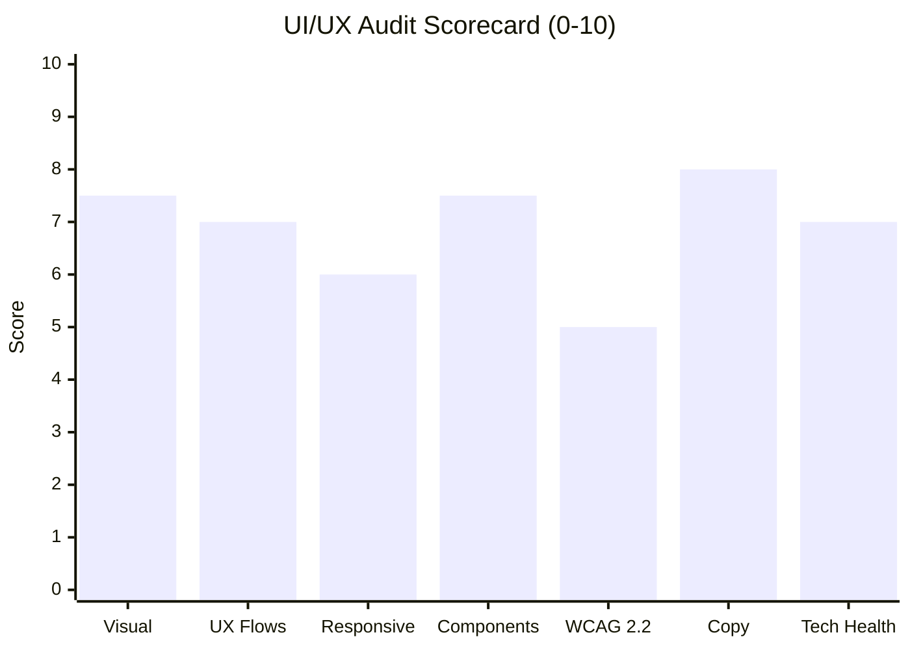
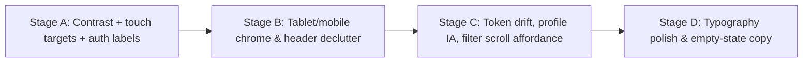

# UI/UX, Design System & Multi-Viewport Audit Report

> [!IMPORTANT]
> **Target URL:** `http://localhost:3000/dashboard` (and key child routes)
> **Audit Date:** 2026-11-15
> **Execution Engine:** Cursor IDE Browser + CDP Unified Mega-Probe
> **Authentication Scope:** Authenticated via local seed admin session
> **Viewports Tested:** Desktop `1440x900`; Tablet/iPad `768x1024`; Mobile `375x812`
> **Overall Verdict:** The dashboard chrome and core ops pages are coherent and domain-dense, but WCAG contrast on gold accents, undersized touch targets, and the `lg:1024` mobile-shell breakpoint leave tablet/mobile UX brittle.

## 1. Executive Scorecard (0-10)

| Dimension | Score | Key Evidence |
| :--- | :---: | :--- |
| **Visual Design & Hierarchy** | `7.5/10` | Clear gold brand accent, KPI cards, grouped sidebar; card density is high but readable |
| **UX Architecture & Flows** | `7/10` | Strong RBAC nav + workbench; mobile bottom nav only covers 4 hubs + Menu |
| **Responsive Quality (PC / iPad / Mobile)** | `6/10` | No page-level overflow on home; tablet (768) still uses mobile chrome; shipments status pills clip off-screen |
| **Interactive Components & Tabs** | `7.5/10` | Chart tabs, status pills, quick peeks work; many icon/check controls under 24–44px |
| **WCAG 2.2 AA Accessibility** | `5/10` | Repeated gold-on-white text ~2.0–4.25:1; unlabeled search fields; sign-in uses `h3` not `h1` |
| **Copywriting & Brand Authenticity** | `8/10` | Domain-specific ops language (“Dispatch aging”, getpasses, container capacity) |
| **Console & Asset Health** | `7/10` | Pages render; first-load compiles are slow in dev; no broken primary route found in crawl |

## 2. Multi-Viewport Visual Walkthrough

Screenshots saved under [`docs/ui-ux-audit/`](./):

| Viewport | File |
| :--- | :--- |
| Sign-in desktop | [audit-signin-desktop-1440.png](./audit-signin-desktop-1440.png) |
| Dashboard desktop | [audit-dashboard-home-desktop-1440.png](./audit-dashboard-home-desktop-1440.png) |
| Shipments desktop | [audit-shipments-desktop-1440.png](./audit-shipments-desktop-1440.png) |
| Dashboard tablet | [audit-dashboard-tablet-768.png](./audit-dashboard-tablet-768.png) |
| Dashboard mobile | [audit-dashboard-mobile-375.png](./audit-dashboard-mobile-375.png) |
| Shipments mobile | [audit-shipments-mobile-375.png](./audit-shipments-mobile-375.png) |

## 3. Page, Tab & Component Coverage Matrix

| Page / Route | Source File | Auth | Desktop | iPad 768 | Mobile 375 | Tabs & Controls Tested | Notes |
| :--- | :--- | :---: | :---: | :---: | :---: | :--- | :--- |
| `/auth/signin` | [src/app/auth/signin/page.tsx](file:///c:/Users/Administrator/jacxishipping/src/app/auth/signin/page.tsx) | Public | `WORKING` | — | — | Email/password, show password, code login | `h3` only; inputs 14px |
| `/dashboard` | [src/app/dashboard/page.tsx](file:///c:/Users/Administrator/jacxishipping/src/app/dashboard/page.tsx) | Auth | `WORKING` | `WORKING` | `WORKING` | Chart tabs Trends/Pipeline/Capacity; 7D/14D/30D; Workbench pills; quick peek | Low-contrast gold + metric colors |
| `/dashboard/shipments` | [src/app/dashboard/shipments/page.tsx](file:///c:/Users/Administrator/jacxishipping/src/app/dashboard/shipments/page.tsx) | Auth | `WORKING` | — | `PARTIAL` | Status pills, search, select-all, result cards | Mobile: status pills extend past viewport; search unlabeled |
| `/dashboard/invoices` | [src/app/dashboard/invoices/page.tsx](file:///c:/Users/Administrator/jacxishipping/src/app/dashboard/invoices/page.tsx) | Auth | `WORKING` | — | — | Search, status select, row checkboxes | Gold container links ~2.01:1; unlabeled inputs |
| `/dashboard` mobile drawer | [Sidebar.tsx](file:///c:/Users/Administrator/jacxishipping/src/components/dashboard/Sidebar.tsx) | Auth | — | — | `WORKING` | Full nav list, close X, Sign Out | Dual openers: header + bottom Menu |
| Bottom nav | [BottomNavigation.tsx](file:///c:/Users/Administrator/jacxishipping/src/components/mobile/BottomNavigation.tsx) | Auth | hidden `lg+` | `WORKING` | `WORKING` | Home / Shipments / Containers / Invoices / Menu | No Finance/Ops shortcut |

**Not live-probed in this pass (inventory only):** finance deep routes, containers detail, operations board, partner portals, MCP, AI logs, users CRUD — source-mapped via Sidebar + route tree (53 `page.tsx` files).

## 4. Multi-Viewport Responsive & Layout Findings

### Desktop (`1440x900`)
- Layout: sticky header + 260px sidebar + scrollable main (`max-w-[1380px]`).
- Home: `hasHorizontalOverflow === false`; chart segment controls and exception workbench render.
- Shipments / Invoices: dense lists work; checkboxes measured at **16×16px** (below WCAG 2.5.8 minimum 24×24).
- Chart range buttons **7D / 14D / 30D** measured ~21–23px tall (below 24px).

### iPad / Tablet (`768x1024`)
- **Desktop sidebar `display: none`; bottom nav `display: block`; hamburger visible.**
- Tablet is treated as mobile until Tailwind `lg` (1024px). Wide content + mobile chrome wastes horizontal space and overloads the header with icons.
- No page-level horizontal overflow on dashboard home.

### Mobile (`375x812`)
- Sticky header ~57px (7%) + fixed bottom nav ~69px (8%) ≈ **15%** viewport chrome (acceptable).
- Dashboard home: no page-level overflow; KPIs stack cleanly.
- Shipments: document width stays 375, but status filter pills (`button.inline-flex.shrink-0`) extend to `right: 607` — clipped unless the pill row scrolls; scroll affordance is weak.
- Header keeps search / quick actions / export / theme / notifications / settings / avatar — crowded on 375.
- Mobile drawer opens from bottom Menu and header hamburger; full RBAC tree available.

## 5. Reverse-Engineered Design System & Token Audit

**Intended tokens** ([globals.css](file:///c:/Users/Administrator/jacxishipping/src/app/globals.css#L204-L265)):
- Surfaces: `--background #F9FAFB`, `--panel #FFFFFF`, `--border #E5E7EB`
- Text: `--text-primary #1C1C1E`, `--text-secondary #5F6368`
- Brand: `--accent-gold #D4AF37`, `--accent-gold-text #8D7A1F` (light)
- Fonts declared: Inter / Urbanist; **live computed family on dashboard was mostly `system-ui`**
- Radii observed: 8px dominant, plus 6 / 12 / 16 / pill

**Token drift / contrast:**
| Token / usage | Observed failure |
| :--- | :--- |
| `--accent-gold` on white/panel | Invoice container links **2.01:1** ([invoices/page.tsx ~L444](file:///c:/Users/Administrator/jacxishipping/src/app/dashboard/invoices/page.tsx#L444)) |
| `--accent-gold-text` on white | Chart tab labels / container codes **4.25:1** (fails AA for normal text) |
| Semantic red/amber numbers on `#F9FAFB` | Overdue **53** ~3.6:1; Pending **449** ~2.06:1 |
| Hardcoded `#D4AF37` gradients | Sidebar/Header avatars bypass CSS vars |
| Status badge dark-on-solid samples | Probe reported ~2.1–2.3:1 on solid fills (verify badge uses tinted vs solid bg) |

## 6. Copywriting & AI/Template Indicator Assessment

- **AI/Generic Template Indicator Score:** `28%`
- Domain copy is strong (“Company Getpasses”, “Dispatch aging”, “Port & Yard”).
- Generic spots: “Operations at a glance.”, “Real-time operational momentum…”, empty chart “No shipments in this period”.
- Profile IA mismatch: Sidebar **My Profile → `/dashboard/settings`** vs Header profile → **`/dashboard/profile`**.

## 7. Consolidated Issue Register (`P0` – `P3`)

| ID | Severity | Page & Viewport | Component / Selector & Source | Observed Evidence | Recommended Fix Spec | Acceptance Criteria |
| :--- | :---: | :--- | :--- | :--- | :--- | :--- |
| `UI-001` | `P1` | Invoices / Shipments / Dashboard (all) | Gold links & amounts using `--accent-gold` / `--accent-gold-text` | Ratios **2.01–4.25:1** on white | Use darker gold text token (≥4.5:1) or underline + primary text for links; keep gold for icons/borders | Contrast ≥4.5:1 normal text |
| `UI-002` | `P1` | Dashboard Workbench | Metric values `53` / `449` / `38` | Red/amber on `#F9FAFB` below 4.5:1 | Pair semantic color with darker text or tinted chip background + dark label | Contrast ≥4.5:1 |
| `UI-003` | `P1` | Shipments / Invoices lists | `input.w-4.h-4` / `input.h-4.w-4` checkboxes | **16×16px** targets | Expand hit area to ≥24×24 (padding/wrapper) without changing visual size if needed | WCAG 2.5.8 pass |
| `UI-004` | `P1` | Dashboard chart | `7D`/`14D`/`30D` buttons | Height **21–23px** | Min height 32–44px or larger padding | ≥24×24 minimum |
| `UI-005` | `P1` | `/auth/signin` | `#email`, `#password` | `font-size: 14px` | Use ≥16px on mobile (or all viewports for auth) | No iOS focus zoom |
| `UI-006` | `P1` | Shipments / Invoices search | `input.ds-form-field-control` / `input.w-full.rounded-lg` | Unlabeled (placeholder only) | Visible `<label>` or `aria-label` | Probe `unlabeledInputsCount === 0` |
| `UI-007` | `P1` | Tablet `768` | Layout chrome `lg:` breakpoint | Mobile shell on iPad portrait | Consider `md:` sidebar or tablet-specific rail; reduce header icon set &lt;1024 | Tablet has durable nav without relying only on bottom bar |
| `UI-008` | `P1` | Mobile header | [Header.tsx](file:///c:/Users/Administrator/jacxishipping/src/components/dashboard/Header.tsx#L210-L295) | 7+ icon actions on 375 | Collapse theme/shortcuts/export into overflow menu on `sm`/`md` | Header fits without crowding logo |
| `UI-009` | `P2` | Shipments mobile | Status filter pills | Elements extend past viewport (`right` up to 607) | Ensure `overflow-x-auto` + fade/scroll hint | Filters discoverable; no accidental page overflow |
| `UI-010` | `P2` | Nav IA | Sidebar vs Header profile | Settings vs Profile routes diverge | Align labels/routes | One clear profile destination |
| `UI-011` | `P2` | Global | Hardcoded `#D4AF37` / semantic hex | Token drift in Header/Sidebar/cards | Prefer CSS vars (`--accent-gold*`, `--success*`) | No new hardcoded brand hexes |
| `UI-012` | `P2` | Mobile nav | BottomNavigation | Finance/Ops only via Menu | Optional Finance shortcut or badge on Menu | High-traffic finance reachable in ≤2 taps |
| `UI-013` | `P2` | `/auth/signin` | Heading hierarchy | Only `h3` “Sign In” | Promote to `h1` | Exactly one logical `h1` |
| `UI-014` | `P3` | Typography | Live fonts | Computed `system-ui` dominates | Ensure Inter/Urbanist applied on dashboard shell | Token fonts appear in computed styles |
| `UI-015` | `P3` | Dashboard home | Empty Movement Trends | “No shipments in this period” | Prefer actionable empty state (change period CTA already exists — tighten copy) | Empty state points to next action |

## 8. Phased Remediation Roadmap

## 9. Strengths Worth Keeping

- Domain-first operations dashboard (exceptions, aging, invoices, containers) rather than generic SaaS fluff.
- Consistent `DashboardSurface` / `DashboardHeader` page shell.
- RBAC-filtered sidebar with aging/overdue badges.
- Mobile drawer + bottom nav covers deep navigation without trapping the user on four routes.
- Light/dark + density tokens already exist in `globals.css`.
