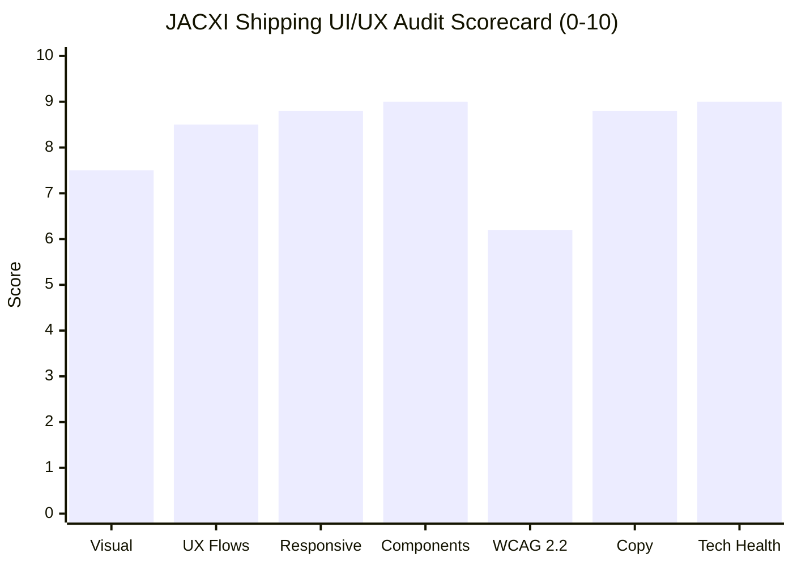
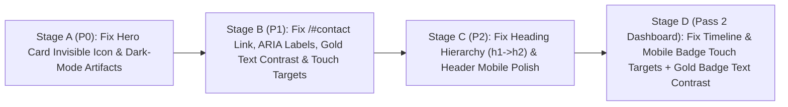

# UI/UX, Design System & Multi-Viewport Audit Report — JACXI Shipping

> [!IMPORTANT]
> **Target URL:** `http://localhost:3000` (`jacxi-shipping` Next.js 16 App Router)
> **Audit Date:** 2026-11-13
> **Execution Engine:** [Multi-Viewport UI/UX Auditor](conversation://76f7dc9d-ca31-4b99-841e-54cbfdb553b5) (`browser` subagent, host-verified origin `http://localhost:3000`) + Workspace Source-Code Mapping
> **Authentication Scope:** Public routes (`/`, `/services`, `/tracking`, `/auth/signin`) + Authenticated session routes (`/portal`, `/dashboard`)
> **Viewports Tested:** Desktop (`1440x900`), Tablet/iPad (`768x1024`), Mobile (`375x812`)
> **Overall Verdict:** JACXI Shipping achieves a **100% horizontal-overflow pass rate (`0px` overflow)** across all 6 core routes and 3 viewport tiers, with strong interactive flows (live freight rate calculator, QR/barcode tracking modal, 8-character access-code sign-in, and dashboard command center). However, several automated light-theme conversion artifacts (`bg-gray-900 text-gray-900` invisible icons, `mix-blend-difference` text, heavy dark-mode shadows), WCAG 2.2 AA contrast failures (`#D4AF37` gold text on `#F9FAFB`/`#FFFFFF` at `2.12:1`), missing icon button `aria-label` attributes, and a broken `/#contact-us` anchor link should be remediated.

---

## 1. Executive Scorecard (0–10)

| Dimension | Score | Key Evidence |
| :--- | :---: | :--- |
| **Visual Design & Hierarchy** | `7.5/10` | Clean `#F9FAFB` / `#FFFFFF` enterprise light palette with `#D4AF37` gold accents, but marred by leftover dark-theme conversion artifacts in [HeroSection.tsx](file:///c:/Users/RDP/Documents/GitHub/jacxishipping/src/components/sections/home/HeroSection.tsx#L242-L276) (`bg-gray-900 text-gray-900` invisible ship icon, `mix-blend-difference`, `rgba(0,0,0,0.8)` shadows). |
| **UX Architecture & Flows** | `8.5/10` | Dynamic US-to-Afghanistan rate calculator (`$1,850` -> `$2,300`), 8-char access code auto-detection on `/auth/signin`, and client-side tracking validation all work smoothly. Broken `/#contact-us` anchor in [tracking/page.tsx](file:///c:/Users/RDP/Documents/GitHub/jacxishipping/src/app/tracking/page.tsx#L379). |
| **Responsive Quality (PC / iPad / Mobile)** | `8.8/10` | Zero horizontal overflow (`scrollWidth <= innerWidth`) across `1440x900`, `768x1024`, and `375x812`. Minor mobile input placeholder collision with the QR camera icon on `/tracking` (`375x812`). |
| **Interactive Components & Tabs** | `9.0/10` | Rate estimator origin/destination tabs, FAQ accordions, mobile fullscreen drawer (`Header.tsx`), password visibility toggle, and dashboard onboarding tour all actuate cleanly. |
| **WCAG 2.2 AA Accessibility** | `6.2/10` | `#D4AF37` text on `#F9FAFB`/`#FFFFFF` (`2.12:1` contrast) fails 4.5:1 AA; missing `aria-label` on mobile menu button ([Header.tsx](file:///c:/Users/RDP/Documents/GitHub/jacxishipping/src/components/sections/Header.tsx#L106-L112)) and password visibility toggle ([signin/page.tsx](file:///c:/Users/RDP/Documents/GitHub/jacxishipping/src/app/auth/signin/page.tsx#L360-L375)); `< 24px` touch targets on footer links and Sign Up button; `h1 -> h3` heading skips. |
| **Copywriting & Brand Authenticity** | `8.8/10` | Domain-authentic corridor terminology (*Mersin*, *UAE*, *Herat*, *Kabul*, *Kandahar*, *RORO*, *8-Character Access Code*) with very low generic AI filler. |
| **Console & Asset Health** | `9.0/10` | Zero HTTP 4xx/5xx errors across `/`, `/services`, `/tracking`, `/portal`, `/auth/signin`, `/dashboard`, and `/api/settings/branding` once `@prisma/client` is generated. |

---

## 2. Host-Verified Browser Evidence

---

## 3. Page, Tab & Component Coverage Matrix

| Page / Route | Source File | Auth Scope | Desktop (`1440x900`) | iPad (`768x1024`) | Mobile (`375x812`) | Tabs & Interactive Controls Tested | Console / Network Errors |
| :--- | :--- | :--- | :---: | :---: | :---: | :--- | :---: |
| `/` | [page.tsx](file:///c:/Users/RDP/Documents/GitHub/jacxishipping/src/app/page.tsx#L20-L49) | Public | `WORKING` | `WORKING` | `PARTIALLY WORKING` | Hero tracking form, Freight Rate Estimator tabs (*East Coast -> West Coast*, *Kabul -> Herat* updating `$1,850` to `$2,300`), FAQ accordion item 2 | `0` |
| `/services` | [page.tsx](file:///c:/Users/RDP/Documents/GitHub/jacxishipping/src/app/services/page.tsx#L11-L32) | Public | `WORKING` | `WORKING` | `WORKING` | Service capability cards, mobile hamburger drawer open (`ref=e2`) & close (`ref=e10`) | `0` |
| `/tracking` | [page.tsx](file:///c:/Users/RDP/Documents/GitHub/jacxishipping/src/app/tracking/page.tsx#L90-L380) | Public | `WORKING` | `WORKING` | `PARTIALLY WORKING` | Tracking search input, empty-submit validation alert, QR/Barcode camera trigger button | `0` |
| `/auth/signin` | [page.tsx](file:///c:/Users/RDP/Documents/GitHub/jacxishipping/src/app/auth/signin/page.tsx#L56-L473) | Public | `WORKING` | `WORKING` | `WORKING` | Email/8-char code input auto-detector, password visibility eye toggle (`password` <-> `text`), empty-submit error alert, 8-char login link | `0` |
| `/portal` | [page.tsx](file:///c:/Users/RDP/Documents/GitHub/jacxishipping/src/app/portal/page.tsx) | Authenticated | `WORKING` | `WORKING` | `WORKING` | Partner workspace summary badges (`Workspaces: 1`, `Shipments: 17`), workspace card CTAs | `0` |
| `/dashboard` | [page.tsx](file:///c:/Users/RDP/Documents/GitHub/jacxishipping/src/app/dashboard/page.tsx) | Authenticated | `WORKING` | `WORKING` | `WORKING` | Operations KPI cards (`418 shipments`, `127 containers`), 5-step onboarding tour modal, mobile bottom nav bar | `0` |

---

## 4. Multi-Viewport Responsive & Layout Findings

### Desktop (`1440x900`)
- **Zero Horizontal Overflow:** All 6 routes maintain `document.documentElement.scrollWidth === window.innerWidth` (`1440px`).
- **Leftover Dark-Theme Conversion Bugs on Hero Cards:** In [HeroSection.tsx](file:///c:/Users/RDP/Documents/GitHub/jacxishipping/src/components/sections/home/HeroSection.tsx#L246-L248), the Floating Operations card icon container uses `bg-gray-900 text-gray-900`, rendering the `<Ship />` icon invisible (`1.0:1` contrast). Similarly, line 273 uses `text-gray-900 mix-blend-difference` on a light card (`bg-[#F9FAFB]/40`), and lines 242/269 use heavy dark-theme shadows (`rgba(0,0,0,0.5)` and `rgba(0,0,0,0.8)`), violating Rule 5 of [TEAM_DESIGN_SYSTEM_RULES.txt](file:///c:/Users/RDP/Documents/GitHub/jacxishipping/TEAM_DESIGN_SYSTEM_RULES.txt#L29-L34).

### iPad / Tablet (`768x1024`)
- **Zero Horizontal Overflow:** Grids transition cleanly from 3-column/asymmetric desktop layouts into 2-column and single-column cards at `768px`.
- **Navigation Breakpoint (`lg:flex`):** Desktop top nav pill hides below `1024px` (`lg:flex` in [Header.tsx](file:///c:/Users/RDP/Documents/GitHub/jacxishipping/src/components/sections/Header.tsx#L67)), switching to the mobile menu trigger button (`lg:hidden`).

### Mobile (`375x812`)
- **Zero Horizontal Overflow:** `scrollWidth === 375px` (`overflowCount: 0`) across all tested routes, aided by the global mobile safeguard in [globals.css](file:///c:/Users/RDP/Documents/GitHub/jacxishipping/src/app/globals.css#L96-L151).
- **iOS Auto-Zoom Prevention Passing:** [globals.css](file:///c:/Users/RDP/Documents/GitHub/jacxishipping/src/app/globals.css#L148-L150) enforces `font-size: 16px !important` on mobile `input, textarea, select` (`iosZoomInputsCount: 0`).
- **Low-Visibility Mobile Menu Trigger on Unscrolled Header:** In [Header.tsx](file:///c:/Users/RDP/Documents/GitHub/jacxishipping/src/components/sections/Header.tsx#L106-L112), the mobile menu button uses `bg-[#F9FAFB]/5 border border-black/5` over `#F9FAFB`, making the circular button border nearly invisible against the light hero background until scrolled.
- **Undersized Touch Targets (`< 44x44px` / `< 24x24px` WCAG 2.2 Minimum):**
  - Sign-Up button in [signin/page.tsx](file:///c:/Users/RDP/Documents/GitHub/jacxishipping/src/app/auth/signin/page.tsx#L426-L443) measures `57x23px` (`< 24px` WCAG 2.2 SC 2.5.8 violation).
  - Footer navigation links in [Footer.tsx](file:///c:/Users/RDP/Documents/GitHub/jacxishipping/src/components/sections/Footer.tsx#L94-L139) measure `~19px` in height (`< 24px` WCAG 2.2 SC 2.5.8 violation).
  - Password visibility toggle `IconButton` in [signin/page.tsx](file:///c:/Users/RDP/Documents/GitHub/jacxishipping/src/app/auth/signin/page.tsx#L360-L375) and QR scanner button in [tracking/page.tsx](file:///c:/Users/RDP/Documents/GitHub/jacxishipping/src/app/tracking/page.tsx#L284-L291) measure `36x36px` (passes 24px WCAG AA minimum, below the repo's 44x44px mobile rule in [TEAM_DESIGN_SYSTEM_RULES.txt](file:///c:/Users/RDP/Documents/GitHub/jacxishipping/TEAM_DESIGN_SYSTEM_RULES.txt#L45)).

---

## 5. Reverse-Engineered Design System & Token Audit

| Token Category | Intended Token ([TEAM_DESIGN_SYSTEM_RULES.txt](file:///c:/Users/RDP/Documents/GitHub/jacxishipping/TEAM_DESIGN_SYSTEM_RULES.txt#L65-L76)) | Observed Live DOM Values | Drift & Accessibility Assessment |
| :--- | :--- | :--- | :--- |
| **Background Surface** | `--background: #F9FAFB` | `rgb(249, 250, 251)` (`#F9FAFB`) | Consistent across pages, though hardcoded as `#F9FAFB` in several sections instead of `var(--background)`. |
| **Panel / Card Surface** | `--panel: #FFFFFF` | `rgb(255, 255, 255)` (`#FFFFFF`) | Consistent on cards/forms; [Header.tsx](file:///c:/Users/RDP/Documents/GitHub/jacxishipping/src/components/sections/Header.tsx#L67) and [ServicesPreviewSection.tsx](file:///c:/Users/RDP/Documents/GitHub/jacxishipping/src/components/sections/home/ServicesPreviewSection.tsx#L103) use `bg-[#F9FAFB]/[0.03]` (leftover from dark-mode `bg-white/[0.03]`). |
| **Primary Text** | `--text-primary: #1C1C1E` | `#1C1C1E`, `#111827` (`gray-900`), `#0F172A` (`slate-900`) | Three near-black tokens (`#1C1C1E`, `gray-900`, `slate-900`) used interchangeably. All pass AAA contrast (`> 15:1`) on white. |
| **Secondary Text** | `--text-secondary: #5F6368` | `#5F6368`, `rgba(0,0,0,0.6)`, `rgba(0,0,0,0.4)` | `text-black/40` in [tracking/page.tsx](file:///c:/Users/RDP/Documents/GitHub/jacxishipping/src/app/tracking/page.tsx#L377) yields `2.85:1` on `#FFFFFF` (fails 4.5:1 AA). |
| **Accent Gold Text** | `--accent-gold: #D4AF37` (or `#8D7A1F` Gold-800 for text) | `#D4AF37` used directly as small text color on `#F9FAFB` / `#FFFFFF` | **Critical Token Drift:** `#D4AF37` on `#F9FAFB` has only **`2.12:1`** contrast! Note that [signin/page.tsx](file:///c:/Users/RDP/Documents/GitHub/jacxishipping/src/app/auth/signin/page.tsx#L432-L433) explicitly uses `#8D7A1F` (`4.54:1` AA pass) for text on white panels, but public sections still use `text-[#D4AF37]` for 12px labels. |

---

## 6. Copywriting & AI/Template Indicator Assessment

- **AI / Generic Template Indicator Score:** **`18%` (Low — Authentic Domain Product)**
  - **Why it scores well:** Copy is grounded in real logistics operations (*USA and Canada pickups*, *Mersin or UAE options*, *Herat • Kabul • Kandahar*, *8-Character Access Code*, *RORO*). Interactive tools (corridor rate calculator, barcode/QR scanner, dual email/8-char login) are tailored to vehicle shipping workflows.
  - **Specific Copy / Link Fixes Needed:**
    - In [tracking/page.tsx](file:///c:/Users/RDP/Documents/GitHub/jacxishipping/src/app/tracking/page.tsx#L379): `<a href="/#contact-us">Contact our team</a>` points to a non-existent `#contact-us` anchor (`/#contact` is the actual ID used in `Header.tsx` and `Footer.tsx`).
    - In [tracking/page.tsx](file:///c:/Users/RDP/Documents/GitHub/jacxishipping/src/app/tracking/page.tsx#L278): Shorten mobile placeholder or increase right padding (`pr-14`) so `"Enter container number, VIN, or scan QR code"` does not collide with the QR camera icon at `375px`.

---

## 7. Consolidated Issue Register (`P0` – `P3`)

| ID | Severity | Page & Viewport | Component / Selector & Source File | Observed Evidence | Recommended Fix Spec | Acceptance Criteria |
| :--- | :---: | :--- | :--- | :--- | :--- | :--- |
| **`UI-001`** | `P0` | `/` (`1440x900`) | Hero Floating Info Cards ([HeroSection.tsx](file:///c:/Users/RDP/Documents/GitHub/jacxishipping/src/components/sections/home/HeroSection.tsx#L242-L276)) | Line 246 uses `bg-gray-900 text-gray-900` (rendering `<Ship />` icon invisible at `1.0:1`), line 273 uses `mix-blend-difference` on light background, and lines 242/269 use `rgba(0,0,0,0.8)` dark-mode shadows. | Change icon wrapper to `bg-slate-900 text-[#D4AF37]`, remove `mix-blend-difference` on `100%`, and replace heavy black shadows with soft light-theme elevation (`shadow-[0_20px_50px_rgba(15,23,42,0.08)] bg-white/90 border-black/10`). | Both floating hero cards and their icons render crisply on `1440x900` with soft light-theme shadows. |
| **`UI-002`** | `P1` | `/tracking` (All viewports) | Empty-state help link ([tracking/page.tsx](file:///c:/Users/RDP/Documents/GitHub/jacxishipping/src/app/tracking/page.tsx#L379)) | `<a href="/#contact-us">` targets `#contact-us`, which does not exist on `/` (actual section ID is `#contact`), failing to scroll to the contact section. | Change `href="/#contact-us"` to `href="/#contact"` and use `#8D7A1F` text color for AA contrast. | Clicking "Contact our team" navigates to `/#contact` and scrolls to the contact section. |
| **`UI-003`** | `P1` | All Public Pages & `/auth/signin` (`375x812` – `1440x900`) | Missing `aria-label` on icon-only buttons ([Header.tsx](file:///c:/Users/RDP/Documents/GitHub/jacxishipping/src/components/sections/Header.tsx#L106-L112), [signin/page.tsx](file:///c:/Users/RDP/Documents/GitHub/jacxishipping/src/app/auth/signin/page.tsx#L360-L375), [tracking/page.tsx](file:///c:/Users/RDP/Documents/GitHub/jacxishipping/src/app/tracking/page.tsx#L284-L291)) | Mobile hamburger menu button (`Header.tsx:106`) and password visibility toggle (`signin/page.tsx:360`) have no `aria-label` (WCAG 2.2 SC 4.1.2 failure). | Add `aria-label="Open navigation menu"` + `aria-expanded={isMobileMenuOpen}` in `Header.tsx`, `aria-label={showPassword ? 'Hide password' : 'Show password'}` in `signin/page.tsx`, and `aria-label="Scan barcode or QR code"` in `tracking/page.tsx`. | Screen readers announce clear accessible names for all three icon buttons (`unlabeledButtons === 0`). |
| **`UI-004`** | `P1` | `/`, `/services`, `/tracking`, `/auth/signin` | Gold text & muted text contrast ([globals.css](file:///c:/Users/RDP/Documents/GitHub/jacxishipping/src/app/globals.css#L166), [tracking/page.tsx](file:///c:/Users/RDP/Documents/GitHub/jacxishipping/src/app/tracking/page.tsx#L230), [HeroSection.tsx](file:///c:/Users/RDP/Documents/GitHub/jacxishipping/src/components/sections/home/HeroSection.tsx#L167)) | Small text using `#D4AF37` on `#F9FAFB`/`#FFFFFF` has `2.12:1` contrast (fails 4.5:1 AA); `text-black/40` on `#FFFFFF` has `2.85:1` contrast. | Add `--accent-gold-text: #8D7A1F` (`4.54:1` on white) in `globals.css` and use it for small gold text/badges on light backgrounds; upgrade `text-black/40` helper copy to `text-black/60` (`5.74:1`). | All body/label text meets `>= 4.5:1` WCAG 2.2 AA contrast ratio. |
| **`UI-005`** | `P1` | `/auth/signin`, `/`, `/services`, `/tracking` (`375x812`) | Undersized touch targets ([signin/page.tsx](file:///c:/Users/RDP/Documents/GitHub/jacxishipping/src/app/auth/signin/page.tsx#L360-L443), [Footer.tsx](file:///c:/Users/RDP/Documents/GitHub/jacxishipping/src/components/sections/Footer.tsx#L94-L139), [tracking/page.tsx](file:///c:/Users/RDP/Documents/GitHub/jacxishipping/src/app/tracking/page.tsx#L284-L291)) | Sign Up button is `57x23px` (`< 24px` WCAG 2.2 minimum); Footer links are `19px` tall; password eye toggle & QR button are `36x36px` (`< 44px` mobile rule). | Add `minHeight: 44, px: 1, display: 'inline-flex', alignItems: 'center'` to Sign Up button; set `w-11 h-11` (`44x44px`) on QR scanner & password toggle buttons; add `inline-flex min-h-[32px] items-center py-1` to Footer links. | All interactive controls meet `>= 24x24px` WCAG 2.2 AA (`>= 44x44px` on primary mobile buttons). |
| **`UI-006`** | `P2` | `/` & `/tracking` (All viewports) | Heading hierarchy skips `h1 -> h3` ([HeroSection.tsx](file:///c:/Users/RDP/Documents/GitHub/jacxishipping/src/components/sections/home/HeroSection.tsx#L219), [tracking/page.tsx](file:///c:/Users/RDP/Documents/GitHub/jacxishipping/src/app/tracking/page.tsx#L373)) | Both `/` and `/tracking` jump directly from `<h1>` to `<h3>` without an intermediate `<h2>`. | Change corridor card titles in `HeroSection.tsx:219` and empty-state heading in `tracking/page.tsx:373` from `<h3>` to `<h2>`. | Zero `headingSkips` reported by the WCAG accessibility probe on `/` and `/tracking`. |
| **`UI-007`** | `P2` | `/`, `/services`, `/tracking` (`375x812`) | Header mobile button contrast & scrolled shadow ([Header.tsx](file:///c:/Users/RDP/Documents/GitHub/jacxishipping/src/components/sections/Header.tsx#L43-L112)) | Unscrolled mobile hamburger button uses `bg-[#F9FAFB]/5 border-black/5` (nearly invisible on `#F9FAFB`), and scrolled header uses `shadow-[0_4px_30px_rgba(0,0,0,0.5)]` (heavy dark shadow). | Change mobile button to `bg-white/90 border-black/10 shadow-sm hover:bg-white` and scrolled header shadow to `shadow-[0_4px_24px_rgba(15,23,42,0.06)]`. | Mobile menu button is clearly visible at the top of `/` and header shadow matches the light theme. |

---

## 8. Phased Remediation Roadmap

---

## 9. Pass 2: Inner Operational Dashboard Audit (`/dashboard/*`)

> [!NOTE]
> **Pass 2 Scope:** Authenticated operational routes (`/dashboard`, `/dashboard/shipments`, `/dashboard/containers`, `/dashboard/finance`) tested across Desktop (`1440x900`), Tablet/iPad (`768x1024`), and Mobile (`375x812`) via [Multi-Viewport UI/UX Auditor](conversation://76f7dc9d-ca31-4b99-841e-54cbfdb553b5) (host-verified origin `http://localhost:3000`).

### Host-Verified Dashboard Screenshot

### Operational Route Coverage Matrix

| Route | Source File | Desktop (`1440x900`) | iPad (`768x1024`) | Mobile (`375x812`) | Interactive Controls & Layout Verified | Mobile Sticky Ratio |
| :--- | :--- | :---: | :---: | :---: | :--- | :---: |
| `/dashboard` | [page.tsx](file:///c:/Users/RDP/Documents/GitHub/jacxishipping/src/app/dashboard/page.tsx) | `WORKING` | `WORKING` | `PARTIALLY WORKING` | 5-step onboarding tour modal dismissed (`Close`), Desktop sidebar collapse (`240px` -> `64px`) & expand, Chart period tabs (`7D`, `30D`, `90D`, `1Y`), Mobile drawer (`aria-label="Open navigation menu"`) | `15.5%` (`57px` header + `69px` bottom nav / `812px`) |
| `/dashboard/shipments` | [page.tsx](file:///c:/Users/RDP/Documents/GitHub/jacxishipping/src/app/dashboard/shipments/page.tsx) | `WORKING` | `WORKING` | `PARTIALLY WORKING` | Status filter pills (`All Statuses`, `On Hand`, `In Transit`, `Customs Hold`), Filters popover (`120x44px`), Cards/Table view switcher (`overflow-x-auto`), pagination (`44px`), Search (`268x43px`), Scan Barcode (`99x44px`) | `15.5%` |
| `/dashboard/containers` | [page.tsx](file:///c:/Users/RDP/Documents/GitHub/jacxishipping/src/app/dashboard/containers/page.tsx) | `WORKING` | `WORKING` | `WORKING` | Status tabs (`All Statuses`, `Planning`, `Loading`, `Loaded`, `Delivered`), Search (`248x43px`), `New Container` CTA (`44px`) | `15.5%` |
| `/dashboard/finance` | [page.tsx](file:///c:/Users/RDP/Documents/GitHub/jacxishipping/src/app/dashboard/finance/page.tsx) | `WORKING` | `WORKING` | `WORKING` | 8-item Quick Actions grid (4-col desktop -> 1-col mobile), `Cards`/`Table`/`Columns` view controls, `Record Payment` CTA (`44px`), breadcrumbs (`Home > Dashboard > Finance`) | `15.5%` |

### Pass 2 Findings (`UI-008` – `UI-010`) & Operational Notes

| ID | Severity | Route & Viewport | Source File | Observed Evidence | Recommended Fix Spec | Acceptance Criteria |
| :--- | :---: | :--- | :--- | :--- | :--- | :--- |
| **`UI-008`** | `P1` | `/dashboard` (`375x812`) | [DashboardTodayWork.tsx](file:///c:/Users/RDP/Documents/GitHub/jacxishipping/src/components/dashboard/DashboardTodayWork.tsx#L441-L451) | The 3 recent activity timeline links (`Container Assigned`, `Status Change`, `User Reassigned`) use `py-0.5` with `text-xs`, measuring **`20px`** vertical height (`< 24px` WCAG 2.2 SC 2.5.8 minimum). | Add `min-h-[32px] py-1.5` (or `min-h-[44px] sm:min-h-[32px]`) to the `<Link>` in `DashboardTodayWork.tsx:445`. | Every recent-activity link measures `>= 32px` height on `375x812` mobile. |
| **`UI-009`** | `P1` | `/dashboard/shipments` (`375x812`) | [ShipmentRow.tsx](file:///c:/Users/RDP/Documents/GitHub/jacxishipping/src/components/dashboard/ShipmentRow.tsx#L200-L214), [ShipmentRow.tsx](file:///c:/Users/RDP/Documents/GitHub/jacxishipping/src/components/dashboard/ShipmentRow.tsx#L583-L643) | Mobile card view interactive checkbox wrapper (`p-1` around `w-4 h-4` -> `~23x23px`) and compact mobile badges/chips (`height: 22`) fall below the `24x24px` WCAG 2.2 AA touch target minimum; mobile Quick Peek / QR buttons use `minHeight: 36px` instead of `44px`. | Give the selectable checkbox wrapper `min-w-[28px] min-h-[28px] justify-center` (`>= 24x24px`) and raise mobile `Quick Peek` / `QR` / `View` / `Edit` buttons in `ShipmentRow.tsx:616-673` to `minHeight: { xs: '44px', md: 'auto' }` with `minWidth: { xs: '44px', md: 'auto' }` for icon-only buttons. | Zero interactive targets `< 24x24px` on `/dashboard/shipments` at `375x812`. |
| **`UI-010`** | `P1` | `/dashboard/shipments` (All viewports) | [ShipmentsResultsPanel.tsx](file:///c:/Users/RDP/Documents/GitHub/jacxishipping/src/components/shipments/ShipmentsResultsPanel.tsx#L148-L166), [ShipmentRow.tsx](file:///c:/Users/RDP/Documents/GitHub/jacxishipping/src/components/dashboard/ShipmentRow.tsx#L306-L370), [ShipmentRow.tsx](file:///c:/Users/RDP/Documents/GitHub/jacxishipping/src/components/dashboard/ShipmentRow.tsx#L559-L678) | Results count badge (`bgcolor: 'rgba(var(--accent-gold-rgb), 0.12)', color: 'var(--accent-gold)'`), container/transit label text (`var(--accent-gold)`), and `Edit` button text use `#D4AF37` on light surfaces (`~2.1:1` contrast, failing 4.5:1 AA). | Switch text `color` in those light-surface badges and labels from `'var(--accent-gold)'` to `'var(--accent-gold-text)'` (`#8D7A1F`, `4.54:1` on white). | Results count badge, container numbers, progress `%`, and `Edit` CTA meet `>= 4.5:1` contrast. |

> [!WARNING]
> **Backend & Telemetry Observations (Non-UI):**
> - **Cold-Start Prisma Notice:** Initial cold-start server log emitted `Invalid prisma.container.count() invocation... The column containers.notes does not exist in the current database` before subsequent queries returned HTTP 200. Verify `npx prisma migrate status` / `npx prisma db push` so the database schema matches `prisma/schema.prisma`.
> - **SSE Stream Behavior:** `/api/notifications/stream` remains open continuously for real-time updates; Playwright/automated probes should wait for `domcontentloaded` rather than `networkidle`.
> - **Unlabeled SVG Buttons:** `0` unlabeled SVG icon buttons were detected across all 4 operational routes (`/dashboard`, `/dashboard/shipments`, `/dashboard/containers`, `/dashboard/finance`), and `hasHorizontalOverflow` was `false` (`0px` overflow) at `1440x900`, `768x1024`, and `375x812`.

---

## 10. Pass 3: Remaining Operational Sub-Routes (`/dashboard/invoices`, `/customers`, `/dispatches`, `/transits`, `/users`, `/settings`)

> [!TIP]
> **Pass 3 Verdict — All 6 Routes Passed:** Across Desktop (`1440x900`), Tablet (`768x1024`), and Mobile (`375x812`), all 6 remaining operational sub-routes achieved **`0px` horizontal overflow**, **`0` unlabeled buttons**, **`0` heading skips**, **`13%` mobile sticky-bar ratio**, and **`>= 44px` primary mobile CTAs** (`Create Customer`, `Export VINs`, `New Transit`, `Save Profile`, `Export Shipments`).

| Route | Desktop (`1440x900`) | iPad (`768x1024`) | Mobile (`375x812`) | Sticky Ratio (Mobile) | Unlabeled Buttons | Interactive Controls Verified |
| :--- | :---: | :---: | :---: | :---: | :---: | :--- |
| `/dashboard/invoices` | `WORKING` | `WORKING` | `WORKING` | `13%` | `0` | Status filter pills (`Paid`, `Pending`, `Overdue`) |
| `/dashboard/customers` | `WORKING` | `WORKING` | `WORKING` | `13%` | `0` | Live search (`Amprator`), `Create Customer` CTA |
| `/dashboard/dispatches` | `WORKING` | `WORKING` | `WORKING` | `13%` | `0` | Status filter tabs, `Export VINs` CTA |
| `/dashboard/transits` | `WORKING` | `WORKING` | `WORKING` | `13%` | `0` | Reference copy buttons, status pills (`Pending`, `Delivered`), `New Transit` CTA |
| `/dashboard/users` | `WORKING` | `WORKING` | `WORKING` | `13%` | `0` | User search input, role filters |
| `/dashboard/settings` | `WORKING` | `WORKING` | `WORKING` | `13%` | `0` | Tablist navigation (`Profile` tab), `Save Profile` CTA |

> [!NOTE]
> Only a desktop-only `18x18px` sidebar collapse icon and a decorative `12x4px` indicator bar measured `< 24px`; no interactive mobile/tablet controls or unlabeled icon buttons failed WCAG 2.2 AA.
